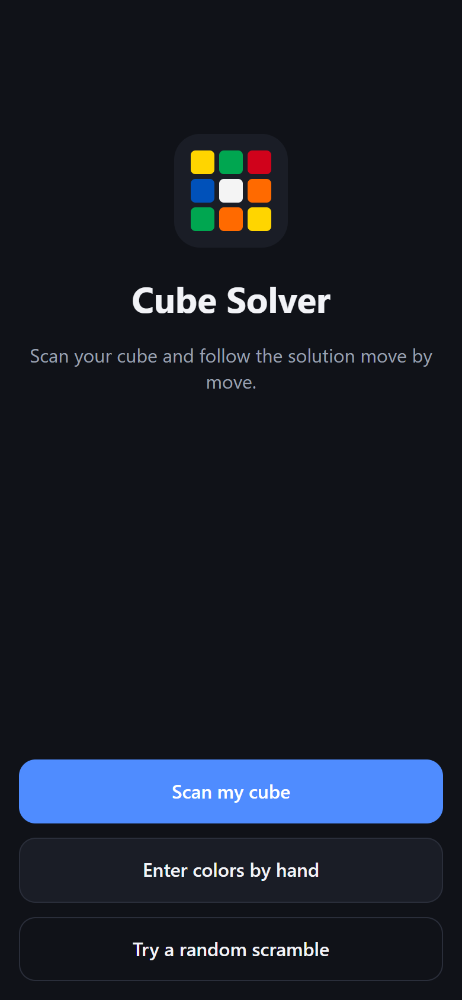
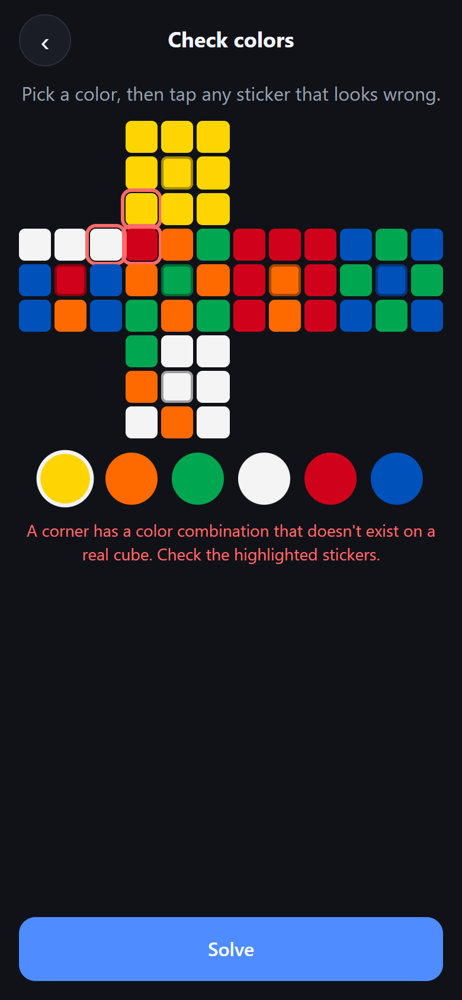
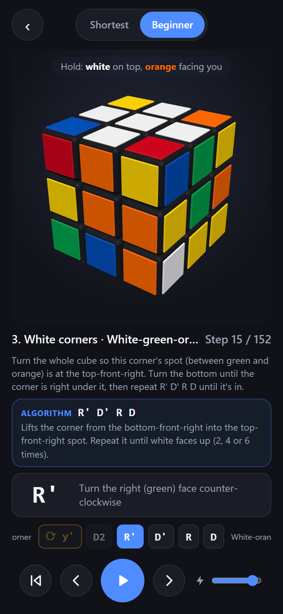
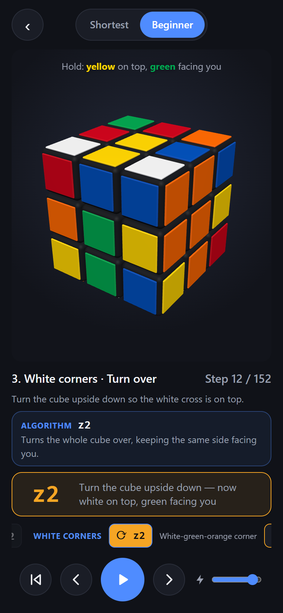

# Cube Solver

Scan your Rubik's cube with your phone camera and follow an animated, step-by-step solution, with no ads and no clutter.

I tried a bunch of apps that solve the cube, but they all had ads or messy, cramped layouts that made the solution hard to follow. So I built my own: one clean screen per step, a 3D cube that shows each move, and the exact notation alongside it.

<p>
  
  
  
  
</p>

## Features

- **Camera scanning.** The app guides you face by face with a live color preview. It checks the scan against the cube's rules (every piece exists exactly once, no impossible twists) and fixes common red/orange mix-ups automatically.
- **Tap-to-fix review.** If something is still off, it tells you what's wrong ("a corner has a color combination that doesn't exist") and highlights the stickers to check.
- **Two solution modes:**
  - **Shortest:** about 20 moves.
  - **Beginner:** the layer-by-layer method as it's usually taught: daisy → white cross → white corners → middle layer → yellow cross (dot / L / line) → yellow face (fish…) → yellow corners (headlights) → yellow edges.
- **Notation that matches your hands.** Beginner mode tells you when to turn the whole cube (`y`, `z2`…), and the 3D cube turns with you, so algorithms always appear in their textbook form, like `R' D' R D` or `F R U R' U' F'`.
- **Algorithm card.** Each step shows the full algorithm and what it does.
- **Smooth 3D playback.** Play, pause, step forward and back, jump to any move, and set the speed from 2.5 s per turn down to very fast.
- **Installs like an app** on iPhone and Android, and works offline after the first visit.

## Use it

Open the hosted link on your phone, then:
- **iPhone (Safari):** tap Share, then **Add to Home Screen**.
- **Android (Chrome):** tap **Install app**.

No camera? Use **Enter colors by hand**, or **Try a random scramble** to see how it works.

## Run it locally

```bash
npm install
npm run dev     # prints a https://<your-ip>:5173 address to open on your phone (same Wi-Fi)
npm test        # solver, scanner and notation tests
npm run build   # production build in dist/
```

Phones only allow camera access over HTTPS, so the dev server uses a self-signed certificate. Tap through the browser warning once.

**Deploy:** run `npm run build` and upload the `dist/` folder to any static host. For example, drag it onto [Netlify Drop](https://app.netlify.com/drop). All paths are relative, so it also works from a sub-folder, such as GitHub Pages.

## How it's built

Vite + TypeScript, no UI framework. The shortest solution uses Kociemba's two-phase algorithm via [cubejs](https://github.com/ldez/cubejs), running in a Web Worker. The beginner solver, cube model, color matching and 3D view ([three.js](https://threejs.org)) are written from scratch.

| File | What it does |
|---|---|
| `src/main.ts` | Screens (home → scan → review → solve) and playback |
| `src/cube.ts` | Cube model, moves, validation, hand positions (`x`/`y`/`z`) |
| `src/beginner.ts` | Beginner method, split into named stages and patterns |
| `src/solver.ts`, `src/solver.worker.ts` | Shortest solver in a background thread |
| `src/scan.ts` | Camera sampling and color matching (with cube-rule correction) |
| `src/net.ts` | Flat cube map for fixing colors |
| `src/player.ts` | 3D cube, layer turns and whole-cube turns |

## Roadmap

- Solve timer and history
- 2×2 and 4×4 cubes
- Shorter beginner solutions
